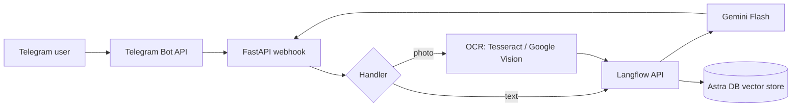

# RuangTutor

**An AI teaching assistant for Indonesian students.** RuangTutor is a Telegram bot that answers subject questions with retrieval-augmented generation (RAG) and grades handwritten homework photos with OCR.

[](https://python.org)
[](https://fastapi.tiangolo.com)
[](https://t.me/RuangTutor_bot)

**Live bot:** [@RuangTutor_bot](https://t.me/RuangTutor_bot)

---

## What it does

| Mode | Description |
|---|---|
| **Tutor** | A student asks a subject question; the bot explains the concept, gives an example, and checks understanding. |
| **Korektor** | A student sends a photo of handwritten homework; OCR extracts the text, the LLM grades it, and the bot recommends what to study next. |
| **RAG** | Answers are grounded in indexed course material stored in Astra DB. |
| **Memory** | Each user has a separate conversation session. |

---

## Architecture



The FastAPI webhook receives Telegram updates. Text messages go to the Langflow RAG agent; photos go through OCR first, then to the same agent. The agent uses Gemini Flash and retrieves course material from an Astra DB vector store.

---

## Tech stack

- Python 3.11+, FastAPI, `python-telegram-bot`
- Langflow (RAG flow, chunking, Astra DB vector store, Gemini agent)
- Gemini Flash (LLM)
- Astra DB (vector search)
- Tesseract OCR / Google Cloud Vision (optional)
- `httpx`, `python-dotenv`

---

## My contribution

I designed and built RuangTutor as a solo project: the FastAPI webhook, the Telegram text and photo handlers, the Langflow RAG flow, the Astra DB vector store, the OCR integration, the deployment scripts, the test suite, and this README.

See [`CONTRIBUTORS.md`](CONTRIBUTORS.md).

---

## Quick start

### 1. Clone the repository

```bash
git clone https://github.com/michaelkevin-hash/RuangTutor.git
cd RuangTutor
```

### 2. Install dependencies

```bash
python -m venv .venv
source .venv/bin/activate      # Windows: .venv\Scripts\activate
pip install -r requirements.txt
```

For local OCR, install Tesseract and the Indonesian language pack:

- Ubuntu/Debian: `sudo apt-get install tesseract-ocr tesseract-ocr-ind`
- macOS: `brew install tesseract tesseract-lang`
- Windows: <https://github.com/UB-Mannheim/tesseract/wiki>

### 3. Configure environment variables

```bash
cp .env.example .env
```

Fill in your own tokens in `.env`. Never commit `.env`; see the table below.

### 4. Run Langflow

```bash
pip install langflow
langflow run
```

Import `langflow/RuangTutor_flow.json` into Langflow, then inject the credentials from `.env`:

```bash
python scripts/update_langflow_credentials.py
```

The script reads `LANGFLOW_API_KEY`, `ASTRA_DB_TOKEN`, `ASTRA_DB_ENDPOINT`, and `GOOGLE_API_KEY` from `.env` and updates the flow through the Langflow API. It never stores secrets in the repository.

### 5. Run the bot locally

```bash
uvicorn main:app --reload --port 8000
```

Expose the local server with ngrok:

```bash
ngrok http 8000
```

Copy the HTTPS URL into `WEBHOOK_URL` in `.env`, then restart `uvicorn`.

### 6. Run in production

```bash
uvicorn main:app --host 0.0.0.0 --port 8000
```

---

## Environment variables

| Variable | Description |
|---|---|
| `TELEGRAM_BOT_TOKEN` | Bot token from [@BotFather](https://t.me/BotFather) |
| `WEBHOOK_URL` | Public HTTPS URL where Telegram can reach the backend |
| `LANGFLOW_API_URL` | Langflow run endpoint |
| `LANGFLOW_API_KEY` | Langflow API key (optional for local auth) |
| `LANGFLOW_BASE_URL` | Langflow base URL for the credential setup script (default `http://127.0.0.1:7860`) |
| `LANGFLOW_FLOW_ID` | Flow ID to update (defaults to the included flow) |
| `LANGFLOW_USERNAME` / `LANGFLOW_PASSWORD` | Optional local login fallback |
| `ASTRA_DB_TOKEN` | Astra DB application token |
| `ASTRA_DB_ENDPOINT` | Astra DB API endpoint |
| `ASTRA_DB_COLLECTION` | Vector collection name (default `vector_materi_jarkom`) |
| `GOOGLE_API_KEY` | Google/Gemini API key used by the Langflow agent |
| `USE_GOOGLE_VISION` | `true` to use Google Cloud Vision instead of Tesseract |
| `GOOGLE_APPLICATION_CREDENTIALS` | Path to the service-account JSON if using Vision |
| `TESSERACT_CMD` | Optional path to the Tesseract binary |
| `HOST`, `PORT`, `DEBUG` | Server settings |

---

## Langflow flow details

The flow in `langflow/RuangTutor_flow.json` contains:

1. **Prompt template** with Computer Networks material (Ethernet, IEEE 802.11)
2. **Split text** — chunk size 1000, overlap 200
3. **Astra DB vector store** — `vector_materi_jarkom`
4. **Agent** — Gemini Flash with a `search_documents` tool
5. **Chat input/output** — connected to the Telegram webhook

---

## Testing

```bash
pip install pytest
pytest -q
```

Some tests require a configured `.env` and a running Langflow instance. The manual scripts in `tests/` are useful for checking OCR and Langflow connectivity.

---

## Security and privacy

- Tokens live in `.env`, which is git-ignored. `.env.example` contains placeholders only.
- If a token is ever exposed, **revoke it first**, then rotate it. Removing a commit is not enough.
- Homework photos are processed for OCR; the app does not intentionally retain them after the response.
- Conversation memory is scoped to a user session; the bot does not ask for or build personal profiles.
- Avoid putting personal data in logs; review log output before sharing it.

---

## Roadmap

- [x] Langflow RAG flow (Astra DB + Gemini)
- [x] FastAPI webhook backend
- [x] Telegram text handler (Tutor mode)
- [x] Telegram photo handler + OCR (Korektor mode)
- [ ] Redis-backed session store for scalability
- [ ] Teacher dashboard (score aggregation)
- [ ] Multi-subject support (beyond Computer Networks)
- [ ] WhatsApp integration via the WhatsApp Business API

---

## License

MIT. See [`LICENSE`](LICENSE).
